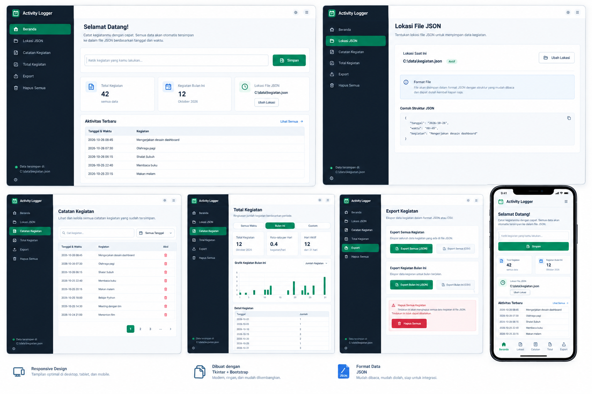

# 📋 Activity Logger

Aplikasi desktop **pencatat kegiatan harian** dengan antarmuka **Tkinter** yang memakai
**sistem desain Bootstrap** (kartu, tombol, badge, nav-pill, alert, tabel, grid responsif).
Komponen Bootstrap-nya diimplementasikan native di Tkinter, jadi tidak butuh browser maupun
aset CSS. Bila paket **`ttkbootstrap`** terpasang, aplikasi juga mendaftarkan tema kustom
`activity-light` / `activitynight-dark` dan memakainya untuk widget ttk (Entry, Combobox,
Scrollbar, Checkbutton).

Alurnya sesederhana ini: **ketik kegiatan → tekan Enter (atau klik Simpan)**. Tanggal dan
waktu terisi otomatis, data langsung tersimpan ke file **JSON**, dan bisa **diekspor ke
CSV/Markdown** untuk laporan harian, mingguan, atau bulanan.

<p align="center">
  
</p>

---

## ✨ Fitur

| | Fitur | Keterangan |
|---|---|---|
| ⚡ | **Input super cepat** | Satu kotak teks + tombol *Simpan*. Tekan `Enter`, selesai. Timestamp otomatis. |
| 🗂️ | **Penyimpanan JSON** | Satu baris = satu kegiatan (JSON Lines), mudah dibaca manusia dan aman untuk Git/backup. |
| 🔎 | **Catatan Kegiatan** | Cari kata kunci, filter periode (hari ini / minggu / bulan / custom), filter status, pagination. |
| 📊 | **Total Kegiatan** | Angka ringkas (total, rata-rata/hari, hari aktif, streak) + grafik batang per hari + detail per hari. |
| 📤 | **Export** | CSV / Markdown / JSON untuk **semua data**, **bulan ini**, **rentang custom**, plus **ringkasan harian**. |
| 📁 | **Lokasi file bebas** | Pindahkan file JSON ke folder mana pun (Dropbox, Google Drive, repo Git). |
| 🌙 | **Mode terang/gelap** | Satu klik di topbar atau `Ctrl+Shift+D`. |
| 📱 | **Akses dari HP** | Server kecil di jaringan Wi-Fi yang sama; buka lewat browser HP dan catat kegiatan dari sana. |
| 🧭 | **Responsif** | Sidebar penuh → ringkas → menu geser, mengikuti lebar jendela. |
| 🔐 | **100% lokal** | Tanpa akun, tanpa cloud, tanpa telemetri. Data milikmu. |
| 🛟 | **Cadangan otomatis** | File cadangan dibuat sebelum penghapusan besar; bisa dipulihkan dari aplikasi. |

---

## 🚀 Instalasi

**Prasyarat:** Python **3.9+** dengan Tkinter.

```bash
# 1. Ambil kode
git clone <repo-ini>
cd activity_logger

# 2. (disarankan) buat virtualenv
python -m venv .venv
source .venv/bin/activate        # Windows: .venv\Scripts\activate

# 3. Pasang dependensi tema Bootstrap
pip install -r requirements.txt
```

Bila Tkinter belum ada:

| OS | Perintah |
|---|---|
| Windows / macOS | Pasang ulang Python dari [python.org](https://www.python.org/downloads/) (opsi **tcl/tk** tercentang) |
| Debian / Ubuntu / Mint | `sudo apt install python3-tk` |
| Fedora | `sudo dnf install python3-tkinter` |
| Arch / Manjaro | `sudo pacman -S tk` |

> `ttkbootstrap` bersifat **opsional**: tanpa paket itu aplikasi tetap berjalan penuh
> dengan tema ttk dasar. Nama mesin tema yang sedang aktif bisa dilihat di halaman
> **Pengaturan → Tampilan**.

---

## ▶️ Menjalankan

```bash
python run.py
```

atau setelah `pip install -e .`:

```bash
activity-logger
```

Opsi baris perintah:

```bash
python run.py --data "D:/Catatan/kegiatan.json"   # tentukan file penyimpanan
python run.py --theme dark                        # mulai dalam mode gelap
python run.py --port 9000                         # port akses dari HP
python run.py --version
```

Ingin mencoba dengan data contoh?

```bash
python scripts/seed_demo.py --force --count 60
python run.py
```

---

## 🧑‍💻 Cara pakai (30 detik)

1. Buka aplikasi → halaman **Beranda**.
2. Ketik kegiatan, mis. `Mengerjakan desain dashboard` → tekan **Enter**.
   Tersimpan otomatis dengan tanggal + jam saat itu.
3. Klik lingkaran di kiri untuk menandai **selesai**; ikon ✏️ untuk **ubah**, 🗑️ untuk **hapus**.
4. Buka **Catatan Kegiatan** untuk mencari/filter, **Total Kegiatan** untuk melihat rekap & grafik.
5. Buka **Export** → **CSV** untuk laporan yang bisa dibuka di Excel/Google Sheets.

### Ekspor yang tersedia

| Tombol | Isi file |
|---|---|
| **CSV / Markdown / JSON — Semua** | Seluruh kegiatan yang pernah dicatat |
| **CSV / Markdown / JSON — Bulan ini** | Rekap bulan berjalan, mis. `kegiatan-2026-10.csv` |
| **CSV / Markdown / JSON — Custom** | Rentang tanggal bebas (mis. 1–15 Oktober) |
| **Ringkasan CSV** | Satu baris per hari: `Tanggal, Hari, Jumlah Kegiatan` |

Semua file ditulis ke folder **`exports/`** di sebelah file JSON kamu
(tombol *Buka folder ekspor* tersedia di halaman Export).

Contoh isi CSV (UTF-8 + BOM agar rapi di Excel):

```csv
No,Tanggal,Hari,Jam,Kegiatan,Status,Timestamp,ID
1,2026-10-20,Senin,15:00:00,Menyusun rencana besok,Belum,2026-10-20 15:00:00,f3a91c07b2d4
2,2026-10-25,Minggu,14:20:00,Rapat tim,Selesai,2026-10-25 14:20:00,8b7e10dd91aa
3,2026-10-26,Senin,06:45:00,Mengerjakan desain dashboard,Belum,2026-10-26 06:45:00,a1b2c3d4e5f6
```

---

## 🗃️ Format file JSON

Default: **`Documents/Activity Logger/kegiatan.json`** (bisa diubah lewat
halaman **Lokasi File JSON**).

```json
{"id":"a1b2c3d4e5f6","tanggal":"2026-10-26","waktu":"06:45:00","kegiatan":"Mengerjakan desain dashboard","selesai":false}
{"id":"8b7e10dd91aa","tanggal":"2026-10-25","waktu":"14:20:00","kegiatan":"Rapat tim","selesai":true}
```

* Satu baris = satu kegiatan (**JSON Lines**) → file tetap enak dibaca dan kecil.
* File berbentuk **array JSON** atau objek `{"activities": [...]}` juga bisa dibuka.
* Nama kunci alternatif (`text`, `activity`, `date`, `time`, `done`, …) ikut dikenali,
  jadi file lama/manual tidak langsung ditolak.
* Penulisan bersifat *atomic* (tulis ke `.tmp` → `replace`) supaya data tidak korup
  bila listrik mati atau aplikasi ditutup paksa.

Aktifkan **cermin Markdown** (Pengaturan / Lokasi File) bila ingin file
`kegiatan-YYYY-MM.md` diperbarui setiap kali menyimpan:

```markdown
## 26 Oktober 2026 — Senin (3)

- [x] `06:45` Mengerjakan desain dashboard
- [ ] `07:30` Olahraga pagi
```

---

## 📱 Catat dari HP (Wi-Fi yang sama)

1. Halaman **Pengaturan** → **Aktifkan Akses HP** (atau `Ctrl+Shift+M`).
2. Aplikasi menampilkan alamat, mis. `http://192.168.1.10:8765`.
3. Buka alamat itu di browser HP (pastikan satu jaringan Wi-Fi).
4. Tambah/centang/hapus kegiatan dari HP — desktop otomatis ikut diperbarui.

Server hanya mendengarkan di jaringan lokal, tanpa autentikasi, jadi matikan bila
sedang memakai Wi-Fi publik.

---

## ⌨️ Pintasan keyboard

| Pintasan | Fungsi |
|---|---|
| `Ctrl+N` | Fokus ke kotak input cepat |
| `Ctrl+F` | Cari di halaman Catatan |
| `Ctrl+Shift+E` | Export CSV bulan ini |
| `Ctrl+Shift+A` | Export CSV semua kegiatan |
| `Ctrl+Shift+D` | Ganti mode terang/gelap |
| `Ctrl+Shift+M` | Aktifkan/matikan akses HP |
| `Ctrl+1` … `Ctrl+7` | Pindah halaman |
| `F5` | Muat ulang data dari file |
| `Esc` | Tutup menu geser / dialog |

---

## 📐 Responsif

| Lebar jendela | Tata letak |
|---|---|
| ≥ 1060 px | Sidebar penuh + 3 kartu sejajar, tabel 3 kolom |
| 860–1060 px | Sidebar penuh, jarak lebih rapat |
| 700–860 px | Sidebar jadi ikon, daftar tetap ringkas |
| < 700 px | Sidebar jadi menu geser (☰), kartu menumpuk, waktu di bawah teks |

Ukuran jendela terakhir diingat, begitu juga halaman terakhir yang dibuka.

---

## 🧱 Struktur proyek

```
activity_logger/
├── run.py                     # titik masuk: python run.py
├── requirements.txt
├── pyproject.toml             # metadata paket + console script
├── activity_logger/
│   ├── cli.py                 # argumen CLI + pengecekan prasyarat
│   ├── core/                  # logika tanpa UI (mudah dites)
│   │   ├── models.py          # Activity (satu kegiatan)
│   │   ├── storage.py         # baca/tulis JSON, cadangan, cermin Markdown
│   │   ├── exporter.py        # CSV / Markdown / JSON
│   │   ├── stats.py           # periode, filter, ringkasan, data grafik
│   │   ├── settings.py        # preferensi (folder config per OS)
│   │   ├── mobile_server.py   # API + halaman web untuk HP
│   │   └── timeutil.py        # tanggal Indonesia, parsing toleran
│   └── gui/
│       ├── app.py             # shell, routing halaman, aksi global
│       ├── theme.py           # palet terang/gelap + integrasi ttkbootstrap
│       ├── widgets.py         # Card, Button, Chip, ActivityRow, BarChart, Toast, Modal…
│       ├── icons.py           # ikon vektor yang digambar di Canvas (tanpa emoji)
│       ├── appicon.py         # ikon jendela (PNG disematkan base64)
│       └── pages/             # beranda, catatan, total, export, lokasi, hapus, pengaturan
├── scripts/
│   ├── seed_demo.py           # isi data contoh
│   └── make_icon.py           # buat ulang ikon aplikasi
├── tests/                     # 144 tes (logika + smoke test GUI)
└── assets/
    ├── mockup.png             # referensi desain
    └── app_icon.png           # ikon aplikasi 64×64
```

---

## ✅ Menjalankan tes

```bash
pip install pytest pyflakes
python -m pytest          # 144 tes
python -m pyflakes activity_logger run.py scripts
```

Tes GUI memakai **Tkinter palsu** (`tests/fake_tk.py`) sehingga tetap bisa dijalankan
di server tanpa layar (CI). Yang diuji: semua halaman terbangun di 4 breakpoint,
alur tambah/ubah/hapus/pulihkan, ekspor file nyata, ganti tema, API server HP,
serta logika tanggal/penyimpanan/ekspor. Tak ada layar (X server) yang dibutuhkan.

### Performa

* Menambah kegiatan memakai *append* satu baris + `fsync` → **±0,5 ms** per catatan
  (3.000 catatan: ~1,4 detik total, dibandingkan 35 detik bila menulis ulang seluruh file).
* Membuka ulang 3.000 catatan ±30 ms; pencarian/filter dihitung di memori.
* Edit/hapus tetap menulis ulang file secara atomik agar urutan tetap rapi.

---

## ❓ Troubleshooting

**`ModuleNotFoundError: No module named 'tkinter'`**
→ Tkinter belum terpasang (lihat tabel instalasi di atas).

**`Tidak bisa membuka jendela aplikasi: no display name`**
→ Kamu menjalankan di server/SSH tanpa GUI. Jalankan di desktop, atau gunakan
aplikasi web HP lewat `python run.py` di mesin yang punya layar.

**Penasaran mesin tema yang dipakai?**
→ Halaman **Pengaturan → Tampilan** menampilkan `ttkbootstrap · tema activity-light`
   (atau `ttk dasar` bila paket opsional belum terpasang).

**HP tidak bisa membuka alamat**
→ Pastikan HP & komputer di Wi-Fi yang sama dan firewall mengizinkan port 8765
(Windows: izinkan *Python* pada dialog firewall).

**File JSON rusak sebagian**
→ Aplikasi tetap membuka baris yang valid dan memberi tahu jumlah baris yang
dilewati. Data lama juga tersimpan di folder `backups/`.

---

## 📄 Lisensi

Bebas dipakai dan dimodifikasi untuk keperluan pribadi maupun kerja.
